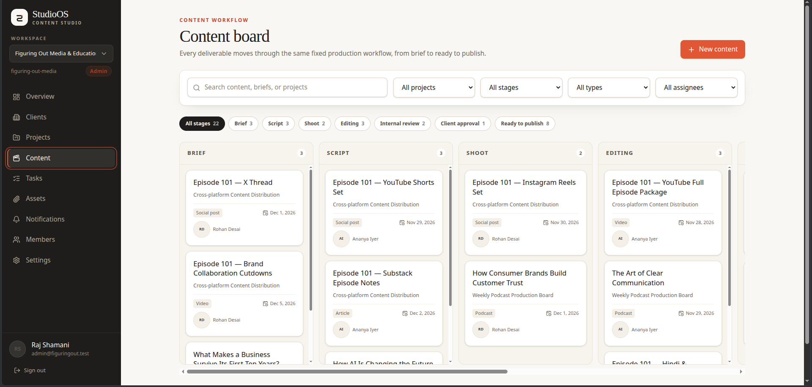
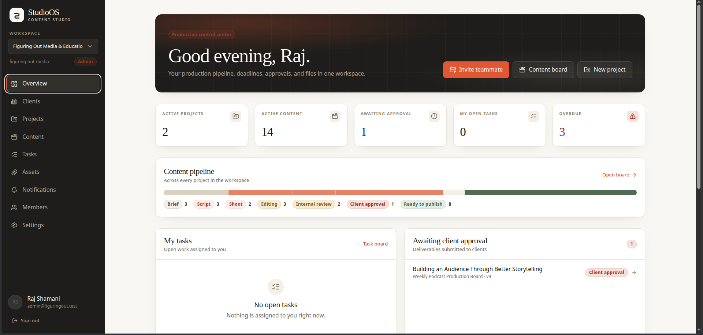

# StudioOS

StudioOS is a multi-tenant content production and operations platform for media agencies. It gives
studios one workspace to manage clients, projects, deliverables, tasks, assets, reviews, and client
approvals — with separate internal and client-facing experiences.





## What it does

- **Clients and projects** — client accounts, portal invitations, project teams, and deliverables.
- **Content workflow** — a fixed pipeline from brief to publish, with versioned transitions and
  full event history.
- **Tasks** — assignment, statuses, priorities, deadlines, filters, and overdue views.
- **Assets** — direct-to-storage uploads, verified files, and secure short-lived download links.
- **Reviews and approvals** — internal feedback plus client approval or revision requests through a
  dedicated portal.
- **Teams and roles** — organizations, memberships, invitations, and scoped permissions for admins,
  project managers, producers, editors, and clients.
- **Account security** — email OTP verification on signup plus optional Google and GitHub OAuth.
- **Notifications** — in-app alerts, email delivery, and deadline reminders.
- **Dashboard** — a role-aware overview of projects, content, and workload.

Access is tenant-isolated throughout: client users only see their own projects, and internal users
only see the projects they belong to.

## Stack

- **Runtime:** Node.js + TypeScript
- **API:** Express 5
- **Database:** PostgreSQL + Prisma
- **Web:** React 19 + Vite + Tailwind CSS
- **Jobs:** Redis + BullMQ
- **Storage:** S3-compatible object storage
- **Tooling:** Vitest, Playwright, Docker Compose, GitHub Actions

## Run locally

Requires Node.js 22.12+, npm, and Docker.

```bash
npm install
cp .env.example .env        # set SESSION_SECRET and SEED_PASSWORD
npm run infra:up            # PostgreSQL, Redis, and local S3 mock
npm run db:migrate
npm run db:seed             # optional demo data
npm run dev                 # start API, web app, and worker
```

The web app runs at http://localhost:5174 and the API at http://localhost:4000.

Also available: `npm test`, `npm run test:e2e`, `npm run build`, `npm run lint`, and
`npm run typecheck`.

## Signup verification and OAuth

New accounts receive a single-use 6-digit code by email and cannot sign in until it is verified.
With `EMAIL_PROVIDER=console`, the code is printed in the API response as `devCode` when
`DEV_LINKS_ENABLED=true`; production always delivers it through the configured email provider.

OAuth is optional and enabled per provider. Create an OAuth app with Google and/or GitHub, then set
the matching `GOOGLE_CLIENT_ID`, `GOOGLE_CLIENT_SECRET`, and `GOOGLE_CALLBACK_URL` (or the `GITHUB_*`
equivalents) from `.env.example`. The callback URL must be
`<API_BASE_URL>/auth/oauth/<provider>/callback`. OAuth signups get a starter workspace named after
the user; verified provider emails are linked to existing accounts.

## Demo accounts

`npm run db:seed` creates these demo accounts for the seeded **Figuring Out Media & Education**
workspace. All five share the password configured in `SEED_PASSWORD` when the seed runs (minimum 12
characters). Set your own development-only value in the local `.env` before seeding; the seed refuses
to run when `NODE_ENV=production`.

| Role | Name | Email | Access |
|---|---|---|---|
| Admin | Raj Shamani | `admin@figuringout.test` | Full workspace access |
| Project Manager | Eram Dalwai | `manager@figuringout.test` | Clients, projects, and delivery teams |
| Producer | Rohan Desai | `producer@figuringout.test` | Assigned projects and content |
| Editor | Ananya Iyer | `editor@figuringout.test` | Assigned content and tasks |
| Client contact | Maya Kapoor | `client@figuringout.test` | Client portal for Figuring Out Originals only |

The client account has no internal organization membership. It can only review and approve its own
client's deliverables. Sign in with any email above and the `SEED_PASSWORD` value used for the seed.
The [seed-data guide](docs/seed-data.md) shows an example seed command and documents the full seeded
dataset.

## Permissions

Authorization is centralized in `packages/shared/src/index.ts` (`ROLE_PERMISSIONS`). The client role
is not an internal organization role: access comes from a `ClientMembership` and is limited to the
client portal.

| Capability | Admin | Project Manager | Producer | Editor | Client |
|---|---|---|---|---|---|
| Manage organization settings | Yes | No | No | No | No |
| Invite and manage internal members | Yes | No | No | No | No |
| View organization member directory | Yes | Yes | No | No | No |
| Manage clients and portal invitations | Yes | Yes | No | No | No |
| Create and manage projects and teams | Yes | Yes | No | No | No |
| View projects and content | All | All | Assigned | Assigned | Own client |
| Create content | Yes | Yes | Yes | No | No |
| Move content through the workflow | Any stage | Any stage | Production stages; cannot submit to client | Editing → internal review | No |
| Create and edit tasks | Yes | Yes | Yes | No | No |
| Update task status | Any task | Any task | Any task | Assigned tasks | No |
| Upload assets | Yes | Yes | Yes | Yes | Download only |
| Internal review | Yes | Yes | Yes | Yes | No |
| Approve or request revisions | No | No | No | No | Own client |
| Dashboard scope | Organization | Organization | Assigned projects | Personal | No |

## Documentation

- [Security review](docs/security-review.md)
- [Production runbook](docs/production-runbook.md)

## License

Proprietary — internal StudioOS project.
